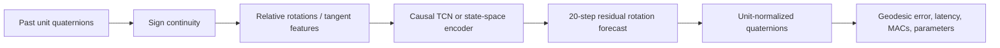

# Efficient XR Head-Pose Forecasting

Efficient, strictly causal prediction of future head orientation from streaming
quaternion motion. The project studies the accuracy–latency–model-size frontier
for deployable XR motion prediction.

The current method is a 17,852-parameter causal depthwise TCN. It predicts a
bounded tangent-space intervention, a blend gate against the constant-pose
fallback, and diagonal predictive uncertainty.

## Task

Given up to 400 past samples at 100 Hz, predict the next 20 unit quaternions.
The primary accuracy measure is mean geodesic angular error at the twentieth
future sample.



## Data governance

BOXRR-23 contains human motion data and requires acceptance of the Berkeley
Data Use Agreement. It is licensed CC BY-NC-SA 4.0. The DUA prohibits
deanonymization, sensitive-attribute inference and health research. This
project uses the data only for aggregate XR motion forecasting.

Official source and DOI:

- <https://rdi.berkeley.edu/metaverse/boxrr-23/>
- <https://doi.org/10.25350/B5NP4V>

Raw recordings, user identifiers and extracted per-user trajectories are never
committed. Splits are user-disjoint and stored as hashed manifests.

## Evaluation-first roadmap

1. Implement exact quaternion geodesic evaluation and constant-pose/velocity
   baselines.
2. Build a selective BOXRR-23 downloader after explicit DUA acceptance.
3. Filter sessions by sampling rate and motion content without downloading the
   full multi-terabyte corpus.
4. Compare causal MLP, GRU, TCN and compact state-space models.
5. Report user-disjoint confidence intervals, parameters, MACs and CPU latency.
6. Export the selected model to ONNX and test float, dynamic-quantized and
   distilled variants.

The selective downloader, XROR extractor, deterministic user split and learned
gate are implemented. Only code and aggregate results are public; BOXRR
recordings, trajectories, user identifiers, weights and credentials are
excluded.

## Preliminary benchmark-v3 result

The cloud-only benchmark contains 50 anonymous users and 49.23 hours of
processed motion. The fixed split is 40/5/5 users. On 20,000 windows from five
held-out users at a 200 ms horizon, the compact encoder comparison is:

| Method | Mean | p95 | User-macro mean |
| --- | ---: | ---: | ---: |
| Constant pose | 3.666° | 9.096° | 3.647° |
| Residual-gated MLP | 3.198° | 7.679° | 3.183° |
| Residual-gated TCN | 3.188° | 7.656° | 3.173° |
| Residual-gated GRU | **3.162°** | **7.555°** | **3.148°** |

The GRU's paired user-level improvement is -0.499° with a 95% clustered
bootstrap interval of [-0.693°, -0.320°]. In high-motion windows its mean gain
over constant pose is 1.235°. Learned uncertainty ranks error better than
angular speed, while validation-only variance scaling reduces mean absolute
coverage error to 0.028. FP32 ONNX inference reaches 0.112 ms median and
0.208 ms p99 on the measured cloud CPU; dynamic INT8 is smaller but slower.
This remains preliminary because the test cohort has only five users. See the
[aggregate result](results/benchmark-v3.json), [technical report](docs/final_report.md)
and [protocol audit](docs/protocol_audit.md).

## Current reproducible checks

```bash
PYTHONPATH=src pytest -q
PYTHONPATH=src python scripts/run_synthetic_benchmark.py
ruff check .
```

Real-data training, after independently accepting the BOXRR terms and preparing
cloud-side processed shards:

~~~bash
python -m pip install -e '.[dev,ml]'
python scripts/train_boxrr_gate.py /cloud/path/boxrr-benchmark-v1 \
  --output-dir /cloud/path/experiments/gated-tcn-v2 \
  --max-correction-degrees 25
~~~

The synthetic benchmark is not evidence of real-world accuracy. It is a
deterministic validation of quaternion geometry, baseline behavior and the
evaluation path before any governed dataset is accessed.

Uncertainty calibration uses validation users only. A single positive variance
multiplier is fitted by Gaussian maximum likelihood, frozen, and then applied
once to the held-out test users. Reports include Gaussian negative log
likelihood, central-interval coverage from 50% to 95%, and mean absolute
coverage error. This prevents test-set calibration leakage.

## Cloud-only execution

The Runpod image keeps the application under `/opt/headpose` and reserves the
mounted `/workspace` volume for processed data and durable artifacts. See
[`docs/runpod_handoff.md`](docs/runpod_handoff.md) for the authored deployment
contract and the verification status. The public repository does not
redistribute the governed dataset.

